<!-- LOCAL CITY-POP BANNER -->
<a href="https://github.com/bat-e404">
  <picture>
    <source media="(prefers-color-scheme: dark)" srcset="assets/banner-dark.v9.svg">
    <source media="(prefers-color-scheme: light)" srcset="assets/banner-light.v9.svg">
    
  </picture>
</a>

 

# Hi, I'm Bryan 👋

<h3 align="center">A passionate programmer and developer from Mexico 🇲🇽</h3>

Welcome to my GitHub profile! I'm Bryan, a software developer with a love for creating impactful projects. My journey in programming began with web development, and now I’m diving into new technologies and cloud computing! 🚀

## 🔭 Currently working on

- **INAP** — An exciting project I'm building to improve the customer experience.

## 🌱 I'm learning

- **Next.js, DevOps**, and **Cloud Computing** to enhance my full-stack development skills.

## 👯 Looking to collaborate on

- **IoT projects** that involve hardware and software integration.

## 📫 Get in touch

- **Email**: [bryan_tudon@outlook.com](mailto:bryan_tudon@outlook.com)
- **LinkedIn**: [Bryan Aguirre Tudón](https://www.linkedin.com/in/bryan-aguirre-tudon-055316252/)

 

## `$ cat tech-stack.yaml`

<table border="1" cellpadding="14" bgcolor="#17171c">
  <thead>
    <tr>
      <th colspan="2" align="left"><code>bat-e404:~$ cat tech-stack.yaml</code></th>
    </tr>
  </thead>
  <tbody>
    <tr>
      <td width="50%" valign="top"><code>├─ ⚙ backend_apis:</code>  
         
        <code>Laravel · PHP · Python · FastAPI · Flask</code>
      </td>
      <td width="50%" valign="top"><code>├─ ▣ frontend:</code>  
         
        <code>React · Next.js · JavaScript · TypeScript</code>
      </td>
    </tr>
    <tr>
      <td valign="top"><code>├─ ◉ databases:</code>  
         
        <code>MySQL · PostgreSQL</code>
      </td>
      <td valign="top"><code>├─ ✦ ai_agents:</code>  
        
        
         
        <code>LLMs · MCP · AI Agents · Ollama</code>
      </td>
    </tr>
    <tr>
      <td valign="top"><code>├─ ⌁ automation:</code>  
        
         
        <code>n8n · Bash · Python scripts</code>
      </td>
      <td valign="top"><code>╰─ ☁ devops_tools:</code>  
         
        <code>Docker · Linux · Arch · Git · GitHub</code>
      </td>
    </tr>
  </tbody>
  <tfoot>
    <tr>
      <td colspan="2"><code>status: ready&nbsp;&nbsp;·&nbsp;&nbsp;location: Monterrey, MX</code></td>
    </tr>
  </tfoot>
</table>

---

## `$ kubectl get signals --all-namespaces`

  <picture>
    <source media="(prefers-color-scheme: dark)" srcset="assets/radar-dark.svg">
    <source media="(prefers-color-scheme: light)" srcset="assets/radar-light.svg">
    
  </picture>&nbsp;
  <picture>
    <source media="(prefers-color-scheme: dark)" srcset="assets/radar-langs-dark.svg">
    <source media="(prefers-color-scheme: light)" srcset="assets/radar-langs-light.svg">
    
  </picture>

<code>signals: devops_skill_radar · language_stack_radar · status: healthy</code>

---

<!-- SOCIALS -->

## `$ connect --socials`

&nbsp;&nbsp;

 
 

### Thank you for visiting my profile! Feel free to reach out or connect. 😊
